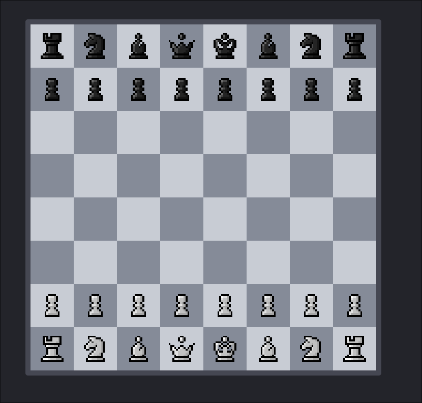

<h1 align="center">
  <a href="https://robertdavidson1.github.io/NanoChess/play/">
    
  </a>
</h1>

<p align="center">
  <i>Train a language model to play chess.</i>
</p>

---

<div align="center">
  
</div>

NanoChess is an experiment in teaching a language model to play chess. Instead of feeding it natural language text, it learns directly from millions of Lichess games, representing moves as tokens and using metadata such as rating, colour, time control, and result to predict what comes next. The goal is a compact chess model that can eventually run privately and entirely in the browser, with no server required.

(WIP) Once trained, the model will be exported to ONNX so the browser can run inference entirely client-side. You can try the chessboard [here](https://robertdavidson1.github.io/NanoChess/play/).

### Getting started

```Bash
# 1. Install uv project manager (if you don't already have it)
curl -LsSf https://astral.sh/uv/install.sh | sh

# 2. Install dependencies
uv sync

# 3. Activate the virtual environment
source .venv/bin/activate

# 4. Fetch data from lichess (~30GB dump)
nc fetch

# 5. Parse and tokenize up to 10 million games
nc parse

# WIP - Only prints a batch atm
# 6. Train the model
# nc train


# WIP - not implemented
# 7. Evaluate the model
# nc eval

# WIP - not implemented
# 8. Export the model to onnx
# nc export

```
